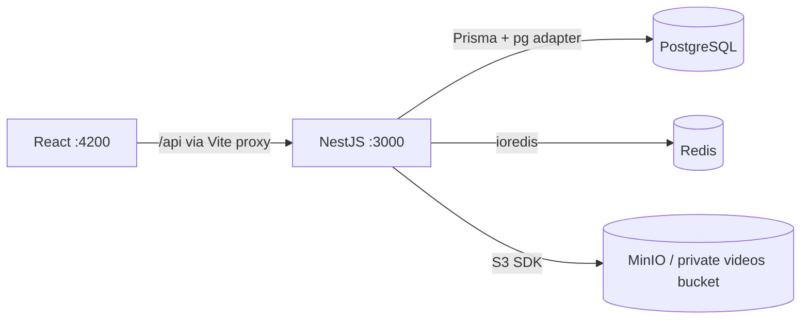

# efiemipeg

A personal video streaming project for learning how uploads, transcoding, buffering, and streaming work. **Phase 1 is the development foundation:** a React dashboard, a NestJS API, and connected PostgreSQL, Redis, and MinIO services.

Accounts, uploads, collections, transcoding workers, range requests, HLS, quality selection, and playback progress are future work. The dashboard reports real service health; it does not simulate an uploaded video library.

## Start locally

Requirements: Node.js 22.12+ (use the pinned `.nvmrc`), npm, Docker with Compose v2, and a running Docker daemon. The first infrastructure start compiles MinIO and can take several minutes.

```sh
nvm install
nvm use
npm ci
npm run setup
npm run infra:up
npm run db:generate
npm run db:deploy
npm run dev
```

`setup` copies `.env.example` to `.env` only if it does not exist. Run commands from the repository root. `npm run dev` runs both applications with file watching through Nx; Ctrl+C stops them. Infrastructure continues running until `npm run infra:down`.

| Service         | Address                                |
| --------------- | -------------------------------------- |
| React dashboard | http://localhost:4200                  |
| API readiness   | http://localhost:3000/api/health/ready |
| API liveness    | http://localhost:3000/api/health/live  |
| MinIO console   | http://localhost:9001                  |
| MinIO S3 API    | http://localhost:9000                  |
| PostgreSQL      | localhost:5432                         |
| Redis           | localhost:6379                         |

Use `MINIO_ROOT_USER` and `MINIO_ROOT_PASSWORD` from `.env` to sign into the local MinIO console. The example credentials are for local development. The services bind to loopback, and the `videos` bucket denies anonymous access. PostgreSQL, Redis, and MinIO retain data in named Docker volumes. `infra:down` preserves those volumes.

## Structure

```text
apps/
  web/                 React + Vite, live infrastructure dashboard
  api/
    src/config/        Validated server environment
    src/health/        Liveness and dependency readiness
    src/infrastructure/ Prisma, Redis, and S3 clients
    test/              HTTP contract and environment tests
docker/minio/          Reproducible upstream MinIO / mc source build
prisma/
  schema.prisma        Initial User model, ready for later authentication
  migrations/          Committed database history
scripts/               Environment setup and live smoke checks
compose.yaml           Local infrastructure and private bucket initialization
```

Nx discovers `api` and `web` through their `project.json` files. Explicit `nx:run-commands` targets keep the tools visible: TypeScript builds the NestJS app, Vite builds React, and Node's test runner runs the API tests. Nx caches builds, type checks, and tests. Prisma generation runs before API compilation. `nx show projects` lists the applications.

## How the services connect



The apps run on the host for fast reloads. Compose runs the infrastructure. API secrets stay on the server; the browser only requests `/api/health/ready`. Vite proxies `/api` to the API port. CORS also allows the configured `WEB_ORIGIN` for direct browser API requests.

The Prisma 7 setup uses `prisma.config.ts` for the migration connection, the `prisma-client` generator, and `@prisma/adapter-pg` at runtime. See the [Prisma PostgreSQL documentation](https://www.prisma.io/docs/orm/v7/core-concepts/supported-databases/postgresql).

## Health checks

| Endpoint                | Behavior                                                        |
| ----------------------- | --------------------------------------------------------------- |
| `GET /api/health/live`  | HTTP 200 while the API can respond; independent of dependencies |
| `GET /api/health/ready` | HTTP 200 if all checks pass; HTTP 503 if any fail               |
| `GET /api/health`       | Alias for readiness                                             |

Readiness performs a real PostgreSQL `SELECT 1`, Redis `PING`, and authenticated S3 `HeadBucket` on the configured bucket concurrently. Responses include service status and measured latency, never raw connection errors or credentials. Queries and network requests have bounded timeouts. Liveness remains available during infrastructure outages, and clients can recover when dependencies return. Readiness checks connectivity, not whether every database migration has been applied; `db:deploy` is a separate setup requirement.

The dashboard refreshes every 15 seconds and supports manual refresh. An API failure clears stale results and displays connection guidance. These diagnostic endpoints are for the local foundation; review exposure when implementing deployment and authentication.

## Commands

| Command                                    | Purpose                                                                 |
| ------------------------------------------ | ----------------------------------------------------------------------- |
| `npm run dev`                              | Watch and serve both apps                                               |
| `npm run dev:api` / `npm run dev:web`      | Serve one app                                                           |
| `npm run check`                            | Type checks, API tests, and builds                                      |
| `npm run smoke`                            | Check both running apps, the Vite proxy, and all dependency connections |
| `npm run build`                            | Output to `dist/apps/api` and `dist/apps/web`                           |
| `npm run infra:up`                         | Build missing local images, start infrastructure, wait for health       |
| `npm run infra:down`                       | Stop infrastructure without deleting data                               |
| `npm run infra:logs`                       | Follow service logs                                                     |
| `npm run db:generate`                      | Regenerate the Prisma client                                            |
| `npm run db:migrate -- --name your_change` | Create and apply a development migration                                |
| `npm run db:deploy`                        | Apply committed migrations                                              |
| `npm run db:studio`                        | Inspect data using Prisma Studio                                        |

The HTTP tests exercise successful readiness, each dependency failing, liveness during failures, recovery, and error redaction. They use stub dependency clients and require no running infrastructure. `smoke` verifies actual connections after starting the apps and containers.

## Environment changes and troubleshooting

- **Ports already in use:** change `API_PORT`, `WEB_PORT`, `POSTGRES_PORT`, `REDIS_PORT`, `MINIO_API_PORT`, or `MINIO_CONSOLE_PORT` in `.env`. Update the corresponding connection URLs and `WEB_ORIGIN` too. Restart apps and rerun `infra:up`.
- **Credentials:** keep `DATABASE_URL` consistent with `POSTGRES_*`; keep `REDIS_URL` consistent with `REDIS_PASSWORD`; keep the `S3_*` credentials consistent with `MINIO_ROOT_*`. URL-encode passwords embedded in connection URLs. Existing PostgreSQL volumes retain the credentials used at initialization; changing `.env` alone does not rotate those database credentials.
- **Docker daemon unavailable:** start Docker Desktop or your Docker engine before running `infra:up`.
- **Missing bucket:** inspect `docker compose logs minio-init` and rerun `docker compose run --rm minio-init`. Provisioning is idempotent, and readiness requires the configured bucket to exist.
- **Database schema missing:** run `npm run db:deploy`. Inspect migration status with `npx prisma migrate status`.
- **Node version errors:** run `nvm use` in the current shell. Prisma requires a supported Node release.
- **Production build:** this phase produces build artifacts, not production hosting. A production web server must proxy `/api` to NestJS, serve the SPA, and configure TLS and appropriate secrets.

## Why MinIO is built locally

The requested upstream MinIO image tags were unavailable from Docker Hub and Quay during setup. Compose therefore builds the official source releases `RELEASE.2025-10-15T17-29-55Z` (server) and `RELEASE.2025-08-13T08-35-41Z` (`mc`) using a multi-stage Dockerfile. Subsequent starts reuse the local image. No host Go installation is needed.

The [MinIO server](https://github.com/minio/minio) and [client](https://github.com/minio/mc) repositories are archived. This preserves MinIO for the requested local learning environment; reassess the storage distribution before a production deployment. Their upstream code is AGPL-3.0 licensed; source and license remain available at those repositories.
