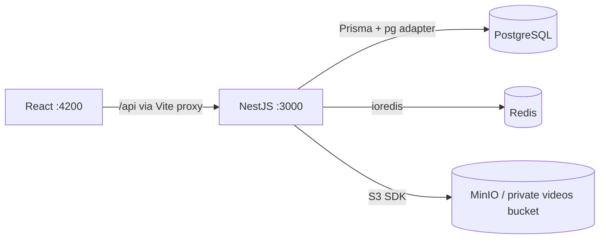

# efiemipeg

A personal video streaming project for learning how uploads, transcoding, buffering, and streaming work. **Phase 2 adds private user accounts** to the React, NestJS, PostgreSQL, Redis, and MinIO foundation.

Users can register, sign in, view their profile, and sign out. Uploads, collections, transcoding, HLS, and playback are future work; the library has an honest empty state. The infrastructure dashboard remains available at `/infrastructure` after signing in.

## Start locally

Requirements: Node.js 22.12+ (use the pinned `.nvmrc`), npm, Docker with Compose v2, and a running Docker daemon. The first infrastructure start compiles MinIO and can take several minutes.

```sh
nvm install
nvm use
npm ci
npm run setup
npm run infra:up
npm run db:generate
npm run db:deploy
npm run dev
```

`setup` copies `.env.example` only if `.env` does not exist, and adds a cryptographically random JWT signing secret when missing. Existing settings and signing secrets are preserved. When upgrading from Phase 1, run `npm install`, `npm run setup`, and `npm run db:deploy` before restarting the apps. Run commands from the repository root. `npm run dev` watches both apps through Nx; Ctrl+C stops them. Infrastructure continues running until `npm run infra:down`.

Open **http://localhost:4200/register** to create your first account. Use the hostname in `WEB_ORIGIN` consistently: `localhost` and `127.0.0.1` are different browser origins. There are no seeded accounts or default account passwords.

## Authentication and profiles

| Endpoint                  | Access               | Behavior                                                                           |
| ------------------------- | -------------------- | ---------------------------------------------------------------------------------- |
| `POST /api/auth/register` | Public, rate limited | Accepts `{ name, email, password }`; creates account and session; returns HTTP 201 |
| `POST /api/auth/login`    | Public, rate limited | Accepts `{ email, password }`; creates session; returns HTTP 200                   |
| `GET /api/auth/me`        | Authenticated        | Returns the current account’s `id`, `name`, `email`, and `createdAt`               |
| `POST /api/auth/logout`   | Authenticated        | Revokes the current session and clears its cookie; returns HTTP 204                |

Registration trims names, trims and lowercases emails, rejects extra fields, and requires a 12–128 character password. Passwords are never trimmed or returned. The database’s unique email constraint handles concurrent duplicate registration. Argon2id uses an independent random salt, 19 MiB memory, two iterations, and parallelism one, following the [OWASP password storage guidance](https://cheatsheetseries.owasp.org/cheatsheets/Password_Storage_Cheat_Sheet.html). Login gives the same message for unknown accounts and wrong passwords and performs password verification for both.

JWTs use HS256 with a private `JWT_SECRET`, a fixed issuer and audience, and expiry. They travel in the `efiemipeg_session` HttpOnly, SameSite=Lax cookie scoped to `/api`; production also sets Secure and requires HTTPS. Tokens are not exposed in JSON responses or stored in localStorage. Sessions last one hour by default (`JWT_TTL_SECONDS`, 300–86400). There is no refresh-token flow: sign in again after expiry. A PostgreSQL `Session` record ties each token ID to its user and expiry; logout revokes it immediately, and deleting an account cascades to its sessions. Expired sessions for a user are pruned on successful login; global scheduled cleanup is not yet implemented.

`AuthGuard` is global: every new API controller is protected unless explicitly marked `@Public()`. Only login, registration, and health checks are public. Request identity comes from the verified JWT and stored session, never a user-supplied account ID. Future video queries must also filter by `request.user.id`; authentication alone does not enforce ownership of future resources.

All state-changing requests require `X-Requested-With: efiemipeg`. Browser requests must also have the configured `WEB_ORIGIN`; credentialed CORS permits only that origin. This includes login to prevent login CSRF. For command-line clients, use a cookie jar and the custom header. The app sends these automatically. Do not add cookie-authenticated state changes on GET routes.

Registration and login share a Redis-backed limit of ten attempts per client IP per 60 seconds. HTTP 429 includes `Retry-After: 60`; Redis failure returns 503 before password hashing. The API does not trust forwarded IP headers. Configure trusted proxies deliberately before deploying behind a reverse proxy.

The browser restores sessions through `/auth/me` on reload, checks them every 30 seconds and on focus, and redirects expired or revoked sessions to login. Profiles are currently read-only. Email verification, password reset/change, profile editing, and video access are outside this phase.

| Service         | Address                                |
| --------------- | -------------------------------------- |
| React dashboard | http://localhost:4200                  |
| API readiness   | http://localhost:3000/api/health/ready |
| API liveness    | http://localhost:3000/api/health/live  |
| MinIO console   | http://localhost:9001                  |
| MinIO S3 API    | http://localhost:9000                  |
| PostgreSQL      | localhost:5432                         |
| Redis           | localhost:6379                         |

Use `MINIO_ROOT_USER` and `MINIO_ROOT_PASSWORD` from `.env` to sign into the local MinIO console. The example credentials are for local development. The services bind to loopback, and the `videos` bucket denies anonymous access. PostgreSQL, Redis, and MinIO retain data in named Docker volumes. `infra:down` preserves those volumes.

## Structure

```text
apps/
  web/                 Login, registration, private account, infrastructure
  api/
    src/config/        Validated server environment
    src/auth/          JWT guard, Argon2id, sessions, auth endpoints
    src/health/        Liveness and dependency readiness
    src/infrastructure/ Prisma, Redis, and S3 clients
    test/              HTTP contract and environment tests
docker/minio/          Reproducible upstream MinIO / mc source build
prisma/
  schema.prisma        User profiles and revocable Session records
  migrations/          Committed database history
scripts/               Environment setup and live smoke checks
compose.yaml           Local infrastructure and private bucket initialization
```

Nx discovers `api` and `web` through their `project.json` files. Explicit `nx:run-commands` targets keep the tools visible: TypeScript builds the NestJS app, Vite builds React, and Node's test runner runs the API tests. Nx caches builds, type checks, and tests. Prisma generation runs before API compilation. `nx show projects` lists the applications.

## How the services connect



The apps run on the host for fast reloads. Compose runs the infrastructure. API secrets stay on the server. Vite proxies `/api` to the API port, including authentication cookies. CORS also allows the configured `WEB_ORIGIN` for direct browser API requests.

The Prisma 7 setup uses `prisma.config.ts` for the migration connection, the `prisma-client` generator, and `@prisma/adapter-pg` at runtime. See the [Prisma PostgreSQL documentation](https://www.prisma.io/docs/orm/v7/core-concepts/supported-databases/postgresql).

## Health checks

| Endpoint                | Behavior                                                        |
| ----------------------- | --------------------------------------------------------------- |
| `GET /api/health/live`  | HTTP 200 while the API can respond; independent of dependencies |
| `GET /api/health/ready` | HTTP 200 if all checks pass; HTTP 503 if any fail               |
| `GET /api/health`       | Alias for readiness                                             |

Readiness performs a real PostgreSQL `SELECT 1`, Redis `PING`, and authenticated S3 `HeadBucket` on the configured bucket concurrently. Responses include service status and measured latency, never raw connection errors or credentials. Queries and network requests have bounded timeouts. Liveness remains available during infrastructure outages, and clients can recover when dependencies return. Readiness checks connectivity, not whether every database migration has been applied; `db:deploy` is a separate setup requirement.

The dashboard refreshes every 15 seconds and supports manual refresh. An API failure clears stale results and displays connection guidance. These diagnostic endpoints are for the local foundation; review exposure when implementing deployment and authentication.

## Commands

| Command                                    | Purpose                                                                                                  |
| ------------------------------------------ | -------------------------------------------------------------------------------------------------------- |
| `npm run dev`                              | Watch and serve both apps                                                                                |
| `npm run dev:api` / `npm run dev:web`      | Serve one app                                                                                            |
| `npm run check`                            | Type checks, API tests, and builds                                                                       |
| `npm run smoke`                            | Check both running apps, the Vite proxy, and all dependency connections                                  |
| `npm run smoke:auth`                       | Verify real registration, password storage, isolation, login, and logout; remove test accounts afterward |
| `npm run build`                            | Output to `dist/apps/api` and `dist/apps/web`                                                            |
| `npm run infra:up`                         | Build missing local images, start infrastructure, wait for health                                        |
| `npm run infra:down`                       | Stop infrastructure without deleting data                                                                |
| `npm run infra:logs`                       | Follow service logs                                                                                      |
| `npm run db:generate`                      | Regenerate the Prisma client                                                                             |
| `npm run db:migrate -- --name your_change` | Create and apply a development migration                                                                 |
| `npm run db:deploy`                        | Apply committed migrations                                                                               |
| `npm run db:studio`                        | Inspect data using Prisma Studio                                                                         |

The HTTP tests exercise health, validation, Argon2id hashing, login, per-account identity, route protection, rejected JWTs, expired/revoked sessions, CSRF checks, cookie attributes, and rate limiting. They use stub infrastructure clients with real hashing/JWT code and require no running containers. `smoke` verifies connectivity; `smoke:auth` checks actual persisted accounts and sessions and deletes only its uniquely named test accounts in a `finally` block. Authentication smoke runs count toward the real rate limit; wait a minute if running repeatedly.

## Environment changes and troubleshooting

- **Ports already in use:** change `API_PORT`, `WEB_PORT`, `POSTGRES_PORT`, `REDIS_PORT`, `MINIO_API_PORT`, or `MINIO_CONSOLE_PORT` in `.env`. Update the corresponding connection URLs and `WEB_ORIGIN` too. Restart apps and rerun `infra:up`.
- **Credentials:** keep `DATABASE_URL` consistent with `POSTGRES_*`; keep `REDIS_URL` consistent with `REDIS_PASSWORD`; keep the `S3_*` credentials consistent with `MINIO_ROOT_*`. URL-encode passwords embedded in connection URLs. Existing PostgreSQL volumes retain the credentials used at initialization; changing `.env` alone does not rotate those database credentials.
- **Docker daemon unavailable:** start Docker Desktop or your Docker engine before running `infra:up`.
- **Missing bucket:** inspect `docker compose logs minio-init` and rerun `docker compose run --rm minio-init`. Provisioning is idempotent, and readiness requires the configured bucket to exist.
- **Database schema missing:** run `npm run db:deploy`. Inspect migration status with `npx prisma migrate status`.
- **Node version errors:** run `nvm use` in the current shell. Prisma requires a supported Node release.
- **Missing JWT secret:** run `npm run setup`; it generates the secret without printing it. Keep it out of version control. Changing it invalidates existing tokens.
- **Sign-in rejected with HTTP 403:** open the frontend using the exact `WEB_ORIGIN` hostname and port. Non-browser clients must send `X-Requested-With: efiemipeg` with POST requests.
- **Production build:** this phase produces build artifacts, not production hosting. A production web server must proxy `/api` to NestJS, serve the SPA, and configure TLS and appropriate secrets.

## Why MinIO is built locally

The requested upstream MinIO image tags were unavailable from Docker Hub and Quay during setup. Compose therefore builds the official source releases `RELEASE.2025-10-15T17-29-55Z` (server) and `RELEASE.2025-08-13T08-35-41Z` (`mc`) using a multi-stage Dockerfile. Subsequent starts reuse the local image. No host Go installation is needed.

The [MinIO server](https://github.com/minio/minio) and [client](https://github.com/minio/mc) repositories are archived. This preserves MinIO for the requested local learning environment; reassess the storage distribution before a production deployment. Their upstream code is AGPL-3.0 licensed; source and license remain available at those repositories.
